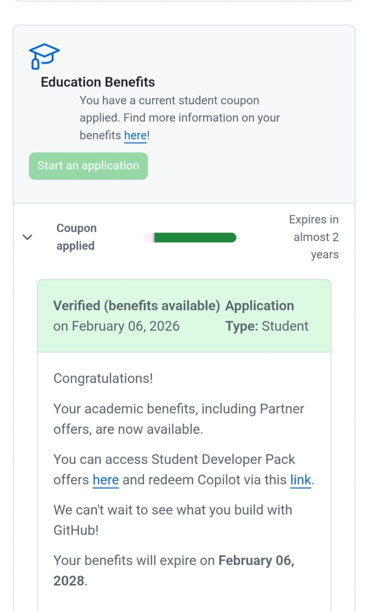

# Tebogo Makgato Digital Portfolio

## 👤 About Me
Final-year ICT (Application Development) student at CPUT with hands-on industry experience from a Microsoft-accredited IT learnership. Built and deployed a live React and Firebase web application used in real-world inspection management. Skilled in full-stack web development across Java, JavaScript, PHP, MySQL, and cloud platforms including Microsoft Azure. Seeking a WIL placement opportunity where I can contribute to real-world software development projects.

---

## 📄 CV

### 📞 Contact Details
- Phone: 081 728 2590
- Location: Woodstock, Cape Town
- Email: 230116086@mycput.ac.za
- GitHub: [My GitHub Profile](https://github.com/tebogomakgato26)
- LinkedIn: [My LinkedIn Profile](https://www.linkedin.com/in/tebogo-makgato-9208492ab)

---

### 🎓 Education
- Matric, Mothimako High School (2021)
- Diploma in ICT (Application Development), CPUT (2024 – 2027 Expected)

---

### 💼 Work Experience
**IT Learnership — Capenexis Data Solutions (Jun 2023 – Nov 2023)**  
- Completed a Microsoft-accredited learnership covering Azure Cloud, Oracle Cloud, and Power Platform  
- Built web apps using Power Apps and Power Automate  
- Supported IT systems and software tools  

---

### 🛠 Skills

**Programming Languages:**
- Java
- JavaScript
- PHP

**Frontend Development:**
- HTML
- CSS
- React

**Backend Development:**
- Laravel
- Node.js
 
**Database:**
- MySQL
- Firebase
- Firestore

**UI/UX:**
- Wireframing
- Prototyping

**Tools & Platforms:**
- GitHub
- GitHub Pages
- VS Code
- XAMPP
- Firebase Console

---

### 🚀 Projects

**InspectEase Web Application (Solo Project)**  
- Web-based inspection management system  
- Managers log in and track daily inspections  
- Stores records securely  
- Technologies: React, Firebase, Firestore  

---

**CampusMate Web Application (Team Project)**  
- Helps students book appointments and get reminders  
- Improves campus service communication  
- Worked on React frontend  
- Technologies: React, Go, MySQL  

---

**Task Management System (Team Project)**  
- Web-based task management application  
- Allows users to create, assign, and manage tasks efficiently  
- Includes authentication, dashboards, and email notifications  
- Technologies: Laravel, PHP, MySQL, Blade, Tailwind CSS  

---

### 📞 References
- Mr Shisana (Supervisor at Capenexis) – +27 71 483 6394  
- Receptionist at Zanami Lodge – +27 81 893 8100

---

## 🎥 Mock Interview Video
[Watch My Mock Interview Video](https://drive.google.com/file/d/1TNFrKLdt5M2julwJEf9XTet7ebsyY7ho/view?usp=sharing)

---

## Reflection on Mock Interview (STAR)

**Situation:**  
I was required to record a mock interview as part of my portfolio to demonstrate my communication and professional skills.

**Task:**  
I needed to answer common interview questions clearly and confidently.

**Action:**  
I prepared by thinking about my skills and experiences, then recorded myself answering the questions in a clear and structured way.

**Result:**  
I improved my confidence and communication skills. I also learned how to present myself professionally in an interview setting.

---

## Reflection on Coding in Markdown (STAR)

**Situation:**  
I was required to create a professional digital portfolio using GitHub and Markdown.

**Task:**  
I needed to learn how to format text properly using Markdown syntax.

**Action:**  
I used headings, bullet points, bold text, and links to organize my CV and portfolio sections in a clean way.

**Result:**  
I learned a useful developer skill and created a professional portfolio that is easy to read.

---

## Reflection on GitHub Pages (STAR)

**Situation:**  
After completing my portfolio, I needed to publish it online.

**Task:**  
I needed to make my portfolio available through a public website link.

**Action:**  
I used GitHub Pages in repository settings and published the portfolio from the main branch.

**Result:**  
My portfolio became accessible online and I learned how developers host websites using GitHub.

---

## 🎓 GitHub Student Account Evidence

